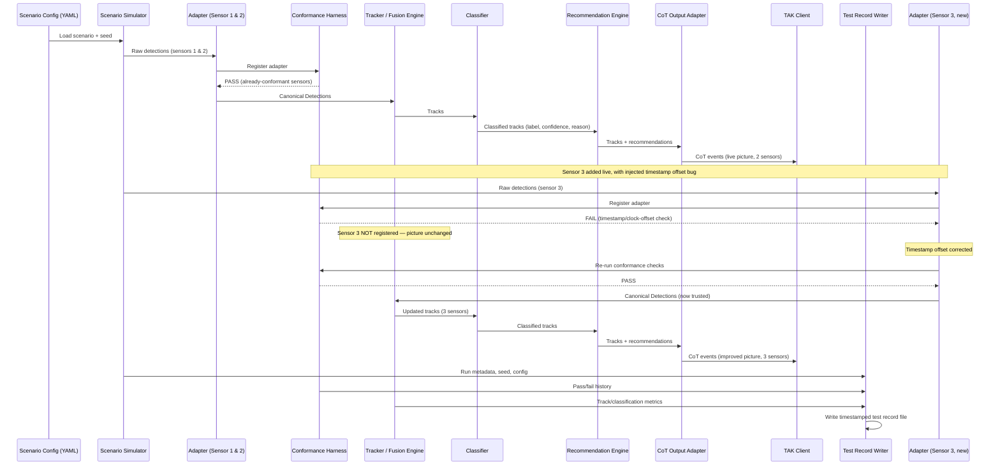
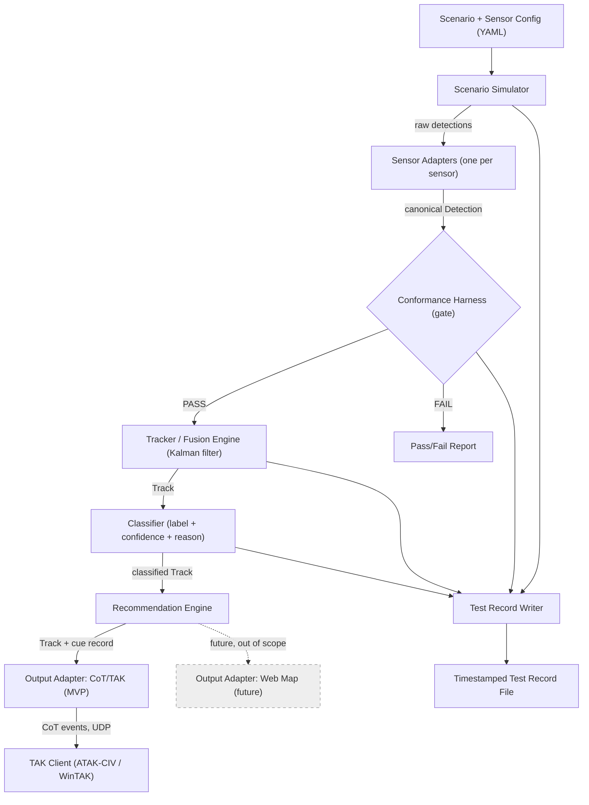

# Plug-and-Prove Architecture

> **How to use this doc:** This is the single source of truth for the system's design. Before writing a new sub-issue under the [epic](https://github.com/onelcruz/plug-and-prove/issues/1), check here first — it defines the components, the contracts between them, and what's already decided vs. still open. If you make an architectural change while implementing a sub-issue, update this doc in the same pull request so it never drifts out of sync.

## 1. System overview and goals

Plug-and-Prove is an offline, fully-simulated demo proving that a counter-drone (C-UAS) system can:

1. Accept a **new sensor** through a documented adapter contract.
2. **Automatically verify** that sensor's integration with a conformance harness before trusting its data.
3. Fuse multiple sensors into **one clean, explainable air picture** on a TAK map.

Everything runs on a single laptop, offline, on simulated data (see [epic #1](https://github.com/onelcruz/plug-and-prove/issues/1) for full constraints: no real sensors, no cloud services, no RF emissions, no effector control).

A deliberately **out of scope for now, designed-for-later** item: a public, Azure-hosted web version of this demo for use on a website. The output layer (section 4) is kept swappable specifically so a future "web map" output adapter can be added without touching the simulator, adapters, harness, fusion, or classifier. No Azure work is planned as part of this epic.

## 2. Major components

| # | Component | Responsibility |
|---|-----------|-----------------|
| 1 | **Scenario Simulator** | Generates ground-truth target (drone), bird, and clutter trajectories, and per-sensor noisy detections, from a seeded YAML config. |
| 2 | **Sensor Adapters** | Translate each sensor's raw simulated output into the canonical `Detection` message defined by the adapter contract. One adapter per sensor. |
| 3 | **Conformance Harness** | Runs contract tests against an adapter's output *before* it is allowed to feed the fusion engine. Produces a pass/fail report. Acts as a gate, not a passive monitor. |
| 4 | **Tracker / Fusion Engine** | Associates detections across sensors into tracks (create/update/coast/delete), using a constant-velocity Kalman filter. |
| 5 | **Classifier** | Labels each track drone / bird / unknown with a confidence score and a one-line plain-language reason. |
| 6 | **Recommendation Engine** | For threat-classified tracks, produces a cue/recommendation record suitable for operator or defeat-system handoff (logged/displayed only — no real effector control). |
| 7 | **Output Adapters** | Pluggable sinks that consume tracks + recommendations. MVP ships one: CoT/TAK output over UDP. A future web-map output adapter can be added here without changing anything upstream. |
| 8 | **Test Record Writer** | Captures every run's scenario, seed, sensor config, harness results, and summary metrics to a timestamped file — the evidence artifact for SBIR claims. |
| 9 | **Orchestrator** | Loads config, seeds the RNG, registers adapters (gated by the harness), and drives the simulation tick loop end to end. |

Suggested package layout (for scoping future sub-issues, not a requirement):

```
plug-and-prove/
├── config/
│   ├── scenarios/        # scenario YAML (targets, birds, clutter, seed)
│   └── sensors/           # per-sensor YAML (accuracy, rate, dropout, offsets)
├── src/
│   ├── simulator/
│   ├── adapters/           # one module per sensor adapter
│   ├── conformance/         # harness + individual checks
│   ├── fusion/              # tracker, Kalman filter, association
│   ├── classification/
│   ├── recommendation/
│   ├── output/
│   │   └── cot/             # MVP output adapter
│   ├── recordkeeping/        # test record writer
│   └── orchestrator.py
├── docs/
│   └── architecture.md
├── runs/                     # generated test records (gitignored or committed, TBD)
└── tests/
```

## 3. The sensor adapter contract

This is the extensibility seam: **adding a new sensor means writing one adapter module + one config entry — no changes to the harness, fusion engine, classifier, or output layer.**

### 3.1 Canonical `Detection` message

Every adapter must emit `Detection` objects with this schema (enforced with `pydantic`, which gives free, structured validation errors for the harness to report):

| Field | Type | Units / Format | Notes |
|---|---|---|---|
| `sensor_id` | str | — | Stable identifier for the reporting sensor |
| `detection_id` | str | — | Unique per detection |
| `timestamp_utc` | float | seconds since Unix epoch (UTC) | Must be within the configured max clock offset of simulator time |
| `lat` | float | decimal degrees, WGS84 | |
| `lon` | float | decimal degrees, WGS84 | |
| `alt_m` | float | meters, above ground level | |
| `accuracy_m` | float | meters, 1-sigma | Positive; used as measurement noise in the Kalman filter |
| `velocity_mps` | float, optional | meters/second | If the sensor provides Doppler/velocity |
| `confidence` | float, optional | 0.0–1.0 | Sensor's own detection confidence/SNR, if available |
| `raw_payload` | dict | — | Original untranslated sensor output, kept for debugging only |

### 3.2 Coordinate frame (decision locked)

- **At the edges** (adapter output, TAK output): WGS84 latitude/longitude/altitude — the real-world standard sensors and TAK both use.
- **Internally** (inside the fusion engine): converted to a local flat ENU (east-north-up, meters) frame relative to a fixed origin (the defended area's center). Kalman filter math is simpler and more numerically stable in flat meters over the small area this demo covers.
- Conversion between WGS84 and local ENU happens at the fusion engine's input/output boundary — adapters and the output layer never need to know about ENU.

### 3.3 Transport (decision locked)

- Adapters are in-process Python objects (function calls / direct method invocation), **not** real network sockets, for this demo. Everything runs in one program on one laptop; real network transport would add failure modes we don't need yet.
- The `Detection` schema is still designed as if it could be serialized over a network (plain field types, no in-memory-only references), so a future adapter for a real networked sensor is a drop-in, not a redesign.

### 3.4 Update rate & heartbeat

- Each sensor config declares an expected update-rate range (e.g. `min_hz`, `max_hz`) and a `heartbeat_timeout_s`.
- An adapter must emit a `Detection` (or an explicit heartbeat/liveness signal, if no target is in view) within `heartbeat_timeout_s`, or the harness/fusion engine treats it as dead.

## 4. The conformance harness (decision locked: pre-ingest gate)

The harness runs as a **gate**, not a passive sidecar: a sensor's adapter must pass every check below before its detections are allowed into the fusion engine. This matches the demo narrative directly — sensor 3 is added, fails on a bad timestamp, and only joins the live picture after the fix and a passing re-run.

Concrete checks (pytest-style, one pass/fail result each, aggregated into a Markdown/HTML report):

1. **Schema** — every `Detection` validates against the pydantic model (required fields, correct types).
2. **Units** — `alt_m` and `accuracy_m` fall within plausible configured bounds; no unit confusion (e.g. feet reported as meters).
3. **Coordinate frame** — `lat`/`lon` fall within the configured defended-area bounding box (WGS84), catching gross frame/projection errors.
4. **Timestamp validity & clock offset** — `timestamp_utc` is not in the future beyond a small tolerance, is not stale, and its offset from simulator reference time is within `max_clock_offset_s`. **This is the check the demo deliberately fails** (sensor 3 ships with an injected timestamp offset bug).
5. **Update rate** — measured inter-detection interval over a short sample window falls within the sensor's configured `[min_hz, max_hz]`.
6. **Heartbeat / liveness** — a `Detection` or heartbeat signal arrives within `heartbeat_timeout_s`.
7. **Dropped-message behavior** — the harness injects synthetic gaps and confirms the fusion engine coasts the affected track gracefully instead of crashing or spawning a duplicate track.

The harness completes in under 60 seconds (epic acceptance criterion) and produces a report listing each check as pass/fail with a one-line reason — mirroring the classifier's "explainable" philosophy.

## 5. Tracker / fusion engine (decision locked: hand-rolled, not Stone Soup)

- A custom constant-velocity Kalman filter per track, implemented directly with `numpy`.
- Rejected Stone Soup (a full tracking framework) for this MVP: its value is handling dozens of edge cases this scripted, time-boxed demo doesn't need. Given the ~25–40 hour budget, a few hundred lines of purpose-built filter code is faster to get right, easier to explain in this doc, and easier to debug on camera than learning and correctly configuring a large framework. Stone Soup remains a documented option if the tracker needs to grow significantly later.
- Responsibilities: data association (nearest-neighbor/gating) across sensors, track creation, update, coasting (through brief dropouts), and deletion (track goes stale).
- Input: canonical `Detection` objects (post-harness-gate, converted to local ENU). Output: canonical `Track` objects (position, velocity, covariance, in both ENU and WGS84).

## 6. Classifier

- Rule-based (not ML/LLM — explicitly out of scope per the epic), operating on track kinematics: speed, acceleration/maneuver pattern, altitude band, path straightness vs. erratic movement.
- Output per track: label (`drone` / `bird` / `unknown`), a confidence score, and a one-line human-readable reason (e.g. "steady altitude and speed inconsistent with bird flight").

## 7. Recommendation engine

- For any track classified as a likely threat (drone, above a confidence threshold, within/approaching the defended area), emits a cue record: track ID, timestamp, position, classification, confidence, reason, and a placeholder suggested action.
- Logged and displayed only. No connection to any real effector or defeat system.

## 8. Output adapters (decision locked: direct CoT, no FreeTAKServer for MVP)

- MVP output adapter converts `Track` and recommendation records into Cursor-on-Target (CoT) XML events and sends them directly over UDP to a single TAK client (ATAK-CIV or WinTAK) on the same machine/network.
- Rejected FreeTAKServer (a relay/server for multiple TAK clients) for the MVP: the demo only needs one viewer on one map; a server to install, configure, and keep alive adds operational complexity with no payoff for a single scripted recording.
- **Extension point:** the output layer is intentionally an interface (`OutputAdapter`) that the fusion/classification/recommendation pipeline doesn't know the concrete type of. A future web-map output adapter (e.g., FastAPI + Leaflet, optionally Azure-hosted) can be added here later as its own separate effort, without modifying anything upstream. This is a deliberate non-goal for the current epic.

## 9. Test record writer

- Wraps each full run and writes a timestamped file capturing: date, scenario name and seed, sensor configuration (including which sensors passed/failed the harness and when), measured results (track counts, false-track rate before/after fusion, classification outcomes), and method (how the numbers were produced).
- This file is the artifact referenced in the epic's "SBIR evidence" purpose — it must be reproducible from a fixed seed.

## 10. End-to-end data flow (maps to the epic's demo scenario steps 1–6)



## 11. Component view



## 12. Key design decisions (locked)

| # | Decision | Alternative considered | Why |
|---|---|---|---|
| 1 | WGS84 lat/lon/alt at component edges; local ENU meters internally for fusion math | Single frame throughout | Simpler, more numerically stable tracker math; matches real-world sensor/TAK conventions at the boundaries |
| 2 | In-process Python objects (pydantic-validated) for adapter transport | Real network sockets between components | No networking failure modes needed for a single-laptop demo; schema still designed to be serializable later |
| 3 | Conformance harness is a pre-ingest **gate** | Passive sidecar monitor that just reports | Matches the demo narrative exactly: bad sensor data is blocked before reaching the operator picture, not reported after the fact |
| 4 | Hand-rolled constant-velocity Kalman filter via `numpy` | Stone Soup tracking framework | Faster to build correctly and explain within the ~25–40 hour budget; Stone Soup's extra capability isn't needed for a scripted demo |
| 5 | Direct CoT over UDP to one TAK client | FreeTAKServer as relay/server | Only one viewer is needed for the MVP; avoids standing up and maintaining a server for no demo benefit |
| 6 | Public, Azure-hosted web version is explicitly deferred | Build hosted version now alongside MVP | Out of scope for the 11/8 deadline; output layer is kept swappable so it's a clean follow-on, not a rebuild |

## 13. Open questions / risks (to resolve in later sub-issues, not this spike)

- Exact bounding box / geographic parameters for the "defended area" used in the scenario config.
- Precise classifier thresholds (speed/altitude/maneuver bands) that separate drone vs. bird vs. unknown — needs tuning against the simulator's actual noise model.
- Exact definition and calculation of the "false threat track" metric used in the before/after fusion comparison (epic acceptance criterion).
- CoT event type codes and update-rate throttling to TAK (avoid flooding the client).
- Whether `runs/` (test record output) is committed to the repo or gitignored.
- Whether heartbeat is a distinct message type or inferred from detection cadence for sensors with no target in view.

## 14. Definition of done for this spike

This document plus the two Mermaid diagrams above are the complete deliverable for [issue #2](https://github.com/onelcruz/plug-and-prove/issues/2). Once merged, sub-issues for the simulator, adapter contract implementation, conformance harness, fusion engine, classifier, recommendation engine, CoT output, and test record writer can be drafted by referencing this doc directly, with no further architecture discussion required.
